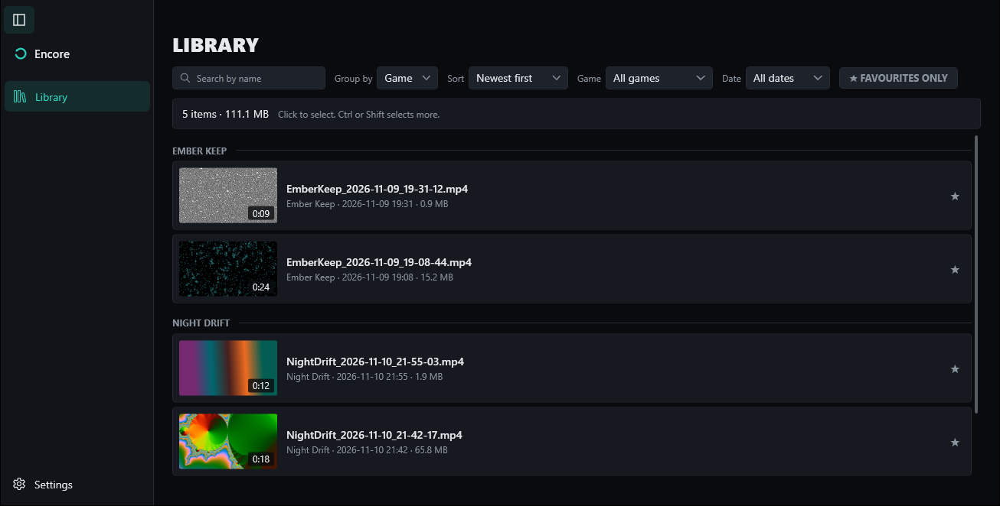
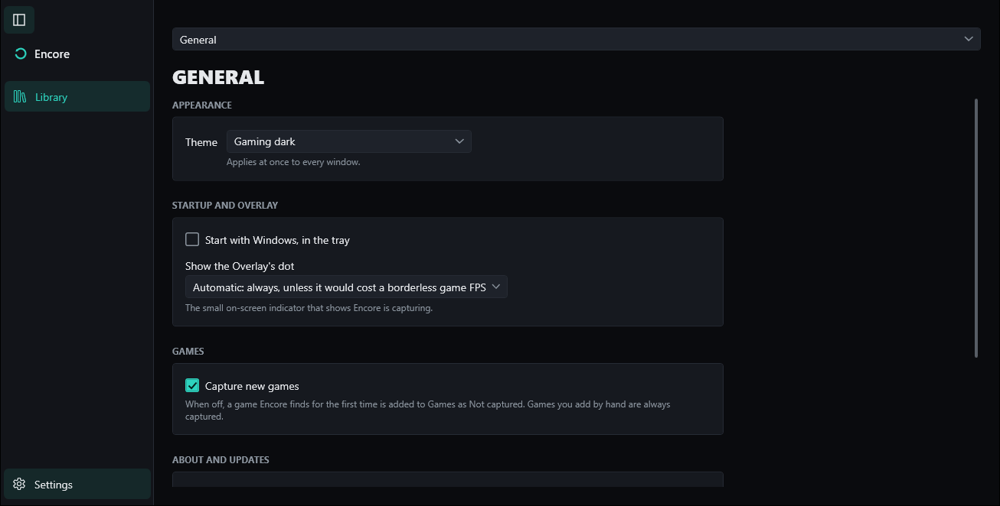

<h1>
  <picture>
    <source media="(prefers-color-scheme: dark)" srcset="branding/encore-lockup-dark.svg">
    
  </picture>
</h1>

**Keep the moment.** 
Instant replay and recording for Windows.

Encore records your games. It sits quietly in the tray, notices when a game starts, and keeps the last few minutes ready. When something great happens, one key press saves it.

## What it does

- **Save what just happened.** While you play, Rewind keeps the last 5 minutes ready. Press **Alt+F10** and they're saved as a Clip. You don't have to remember to start anything.
- **Record the whole match.** A Recording is one long video that you start and stop yourself with **Alt+F9**. Turn Recordings on for a game on its page in Games.
- **Record your screen.** A Monitor Recording captures one screen or several, for anything that isn't a game. Start and stop it with **Alt+Shift+F9**.
- **Finds your games for you.** Encore notices a game starting and adds it to Games. You can give each game its own Clip length and video quality, or tell Encore to leave it alone.
- **Keeps your audio apart.** Game sound, your mic and other devices can each go on their own audio Track, so you can turn your voice down later without touching the game. **Alt+F8** mutes your mic.
- **Keeps everything in one place.** The Library shows every Clip and Recording, with search, favourites and a player that switches between audio Tracks. Trim a Clip in the clip editor before you share it.
- **Looks good without slowing your game.** Encore uses your graphics card's video encoder (NVIDIA, AMD or Intel), and records at your game's own size if you like.
- **Stays out of the way.** A small on-screen notice and a sound tell you a Clip was saved. Encore carries on after sleep, a graphics driver reset or a crash.

You can change every hotkey in Settings › Hotkeys, and the Clip length in Settings › Clips.

## Download and install

1. Download **`EncoreApp-win-Setup.exe`** from the [latest release](https://github.com/BI00dsh0t/Encore/releases/latest).
2. Run it. It installs for your Windows account only, so there's no admin prompt, and it opens Encore when it's done.

**"Windows protected your PC"?** Encore isn't code signed yet, so Windows SmartScreen doesn't know it and may warn you the first time. Choose **More info**, then **Run anyway**. Updates install without it. If you'd like to check the file first, see [Is the download safe?](#is-the-download-safe)

**You need:**

- Windows 11, version 24H2 or later (64-bit).
- A graphics card from NVIDIA, AMD or Intel is recommended. Without one, Encore still works, but it uses your processor to make the videos, which is slower.

## Getting started

1. **Find Encore in the tray.** After it installs, the Encore window opens and an Encore icon appears in the tray by the clock. Closing the window keeps Encore running in the tray, ready to save Clips. To quit, right-click the tray icon and choose **Quit**.
2. **Read the tips.** The Library shows a short tip the first time: your Save Clip key, your Clip length and how to record a whole match. Close it when you've got it; it won't come back.
3. **Play a game.** Start any game. When Encore finds it, a small dot shows on your screen for a moment, and the tray icon's tooltip says **Ready to save Clips**.
4. **Save your first Clip.** When something happens, press **Alt+F10**. You'll hear a sound and see "Clip saved".
5. **Watch it in the Library.** Open Encore from the tray. Your Clip is at the top of the Library. Double-click it to play it, or choose **Create clip** to trim it in the clip editor.
6. **Make it yours.** Click **Settings** at the bottom left of the window. Settings opens over the Library, so you can change something and close it again without losing your place.

A few settings worth knowing:

- **Settings › General:** the look (Gaming dark, or Fluent, which follows Windows), Start with Windows, and updates.
- **Settings › Hotkeys:** every key, and whether the Record key toggles or has separate start and stop keys.
- **Settings › Clips:** how much Rewind keeps, and the video quality.
- **Settings › Audio Tracks:** which sounds go on which Track.
- **Settings › Games:** each game Encore has found, with its own settings. This is where you turn on Recordings for a game.
- **Settings › Storage and Cleanup:** where your Clips go, and automatic cleanup of old ones. Cleanup never deletes a Favourite.

## Updates

Encore checks for updates by itself and installs them the next time it starts. You don't need to download anything again.

To turn that off, or to get beta versions early, open **Settings › General › About and updates**. You can also check for an update right away there.

## Where your files are

| What | Where |
|---|---|
| Your Clips and Recordings | `Videos\Encore`, unless you chose another folder in Settings › Storage and Cleanup |
| Your settings and the Library's list | `%APPDATA%\Encore` |
| Rewind, if you chose to keep it on disk | `%LOCALAPPDATA%\Encore` |
| The app itself | `%LOCALAPPDATA%\EncoreApp` |

To open one of these folders, paste its path into the File Explorer address bar. The tray menu's **Open the Clips folder** takes you straight to your Clips.

## Uninstall

Open Windows **Settings › Apps › Installed apps**, find **Encore**, and choose **Uninstall**.

Your Clips, Recordings and settings stay where they are, so nothing you saved is lost. To remove them too, delete the folders in [Where your files are](#where-your-files-are).

## Questions

### Will it get me banned by anti-cheat?

Encore never injects into a game or hooks it. It records with Windows' own screen capture, the same way Windows' built-in tools do, and its hotkeys are ordinary Windows hotkeys. Nothing of Encore runs inside your game.

### Does it send anything about me?

No. Encore sends nothing about you or your PC anywhere. The only time it goes online is to check GitHub for updates, and you can turn that off in Settings › General › About and updates.

### Is the download safe?

Every release is built automatically on GitHub, from this repository's public code. If you want to check your copy:

- Compare the installer with the release's `SHA256SUMS.txt`. In PowerShell, `Get-FileHash EncoreApp-win-Setup.exe` gives you the value to compare.
- Or, with the [GitHub CLI](https://cli.github.com/) installed, run `gh attestation verify EncoreApp-win-Setup.exe --repo BI00dsh0t/Encore`. It confirms the file was built by this repository.

Updates are signed too, and Encore refuses any update that doesn't match.

### Does it slow my game down?

Very little. The video is made by your graphics card's own encoder, which is separate from the part that draws your game. Without a supported graphics card, the work falls on your processor and you may notice it.

### How much space does it use?

Rewind keeps its 5 minutes in memory, about 1.5 GB at the default quality, so it doesn't fill your drive while you play. Only the Clips and Recordings you save take disk space: a minute of Clip at the default quality is about 300 MB. If your PC is short of memory, Settings › Clips can keep Rewind on disk instead.

### Why didn't my Recording key do anything?

Recordings are off for each game until you allow them. Open Settings › Games, pick the game, and turn on Recordings. Clips work in every game right away.

### My game isn't found. What can I do?

Open Settings › Games and add it by hand. A game you add yourself is always captured.

### Can I share Clips on Discord?

Yes. Clips are ordinary MP4 files. Discord, browsers and most players play the first audio Track. Video editors such as DaVinci Resolve show every Track separately.

## Portable version

Each release also has a zip, if you'd rather not install anything. Unzip it anywhere and run `Encore.App.exe`.

It keeps its own settings, separate from an installed copy, and it doesn't update itself. It also starts with no hotkeys set, so set them first in Settings › Hotkeys. For most people the installer is the better choice.

## Problems and ideas

Found a bug, or have an idea? Open an issue on [GitHub Issues](https://github.com/BI00dsh0t/Encore/issues). Tell us what you did, what you expected and what happened instead.

## License

Encore is free software under the [GNU General Public License v3.0](LICENSE). It includes FFmpeg; [THIRD-PARTY-NOTICES.txt](THIRD-PARTY-NOTICES.txt) lists every third-party component, its license and where to find its source.

### Name and logo

The Encore name and logo identify the official builds from this repository. They are not covered by the GPL: as section 7(e) of the GPL allows, no rights to them are granted, and that includes the files in `branding/` and `src/Encore.App/Icons/`. If you distribute a modified version, give it a different name and icon, so nobody mistakes it for an official Encore build.

## For developers

Building Encore, the release workflow and how updates are signed are in [CONTRIBUTING.md](CONTRIBUTING.md).
