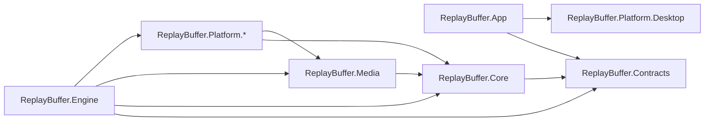

# Architecture Spine — Replay Buffer

## Design Paradigm

**Ports and adapters** in the engine:
- Domain logic depends only on ports.
- One **single-threaded orchestrator** (AD-19) owns every change to session, Target Game, Recording and mute state.
- Windows, D3D, WASAPI and FFmpeg sit behind adapters.

Media flows as **pipes and filters**: Sources → Processors → Encoders → encoded-packet bus → Sinks. The **Main App** is an MVVM client that only talks to the engine over IPC.

| Layer | Project(s) | Holds |
| --- | --- | --- |
| Contracts | `ReplayBuffer.Contracts` | IPC messages, settings key catalog and DTOs, event, warning and error registries |
| Domain | `ReplayBuffer.Core` | SessionOrchestrator, settings `Resolve`, Replay ring, OutputPathAllocator, LibraryActor, ports |
| Media pipeline | `ReplayBuffer.Media` | Filters: pacer, scaler, adaptive resampler, Track mixer and limiter; encoder and muxer ports |
| Adapters | `ReplayBuffer.Platform.*` | WGC/DXGI capture, AudioDeviceHub (WASAPI), FFmpeg, Hotkeys, process monitoring, file system, sounds |
| App adapters | `ReplayBuffer.Platform.Desktop` | The App's Win32 calls: capture exclusion, and story 8's server and process checks |
| Engine host | `ReplayBuffer.Engine` | Composition root, IPC server, NativeAOT executable |
| Client | `ReplayBuffer.App` | WPF: Main App, Library, Settings, Overlay, tray, supervisor |

## Invariants & Rules



### AD-1 — Two processes, one owner per concern [ADOPTED]

- **Binds:** all
- **Prevents:** two components owning the same state; a UI crash stopping capture
- **Rule:**
  - The **engine** owns capture, encoding, the Replay Buffer, Recordings, Hotkeys, Feedback Sounds, Game Detection, settings, the library index and Cleanup.
  - The **Main App** owns UI, the Overlay, the tray and supervision. It never captures, encodes, writes settings, or opens media file contents. It may pass *paths* to the Windows shell: open, show in Explorer, the clipboard (`CF_HDROP`), and shell thumbnails (`IShellItemImageFactory`, `SIIGBF_THUMBNAILONLY`). It never asks for a thumbnail of an item that is being written.
    - **Exception ([AD-27](#ad-27--in-app-player-winrt-mediaplayer-into-a-d3dimage-app-side-and-read-only), 2026-11-05):** the App may open a *finished* media file read-only, shared for read, write and delete, to play it in the in-app player. It never opens a file being written.

### AD-2 — Dependency direction

- **Binds:** all projects
- **Prevents:** UI code reaching into the pipeline; native interop leaking into domain logic
- **Rule:**
  - The diagram above is the only allowed reference graph; `App` and `Engine` never reference each other.
  - `Platform.Desktop` holds the App's own Win32 calls and references nothing; only the App references it. (Story 1.7, 2026-10-25.)
    - That includes the in-app player's D3D11 and D3D9Ex interop (AD-27).
  - Only `ReplayBuffer.Platform.*` contains `unsafe` code, P/Invoke, COM or FFmpeg calls.
  - **Exception (story 11.4, 2026-11-05):** the App compiles `Core/Monitors/MonitorCanvasRule.cs` as a linked source file, so the engine and the Hotkeys screen picker share one canvas rule (AD-25) without an App → Core edge. That file may use only Contracts types. App.Tests sees the type twice (App's copy and, through the engine, Core's), so it must not name it, or it gets CS0433.

### AD-3 — IPC protocol [ADOPTED]

- **Binds:** R8, R13, R19, R27, R28, R30, R31, R34; every epic that adds UI
- **Prevents:** incompatible message shapes; stale or duplicated state after a reconnect; a slow App stalling the engine
- **Rule:**
  - **Pipe:** one named pipe, `ReplayBuffer.Engine.v1.<instance>.<user SID>`. It's created with `FILE_FLAG_FIRST_PIPE_INSTANCE` and an ACL for the current user only. The App checks that the server's image path is in its install folder.
  - **Encoding:** UTF-8 JSON lines, serialized with source-generated `System.Text.Json`, in the envelope `{ v: 1, id, type: "noun.verb", payload }`.
  - **Commands** get exactly one reply, either a result or `{ error: { code, message } }`.
    - On disconnect, every pending command fails locally with `engine-disconnected`.
    - Mutating commands carry their target's identity (`expectedRevision`, or path + size + mtime) and are never auto-retried.
  - **Events** carry `seq`, a number that only increases within one engine instance. `state.snapshot { engineInstanceId, pid, seq, … }` is the first event on connect. It's built under the lock that assigns `seq`, and the App drops events with `seq` ≤ the snapshot's.
    - **Every state the App renders is a field of `state.snapshot`.** Contracts tests map each event type to its snapshot field.
    - Dismissing something is a command (`warning.dismiss`), never local App state.
  - **The Overlay and status line render only two shared shapes,** defined in Contracts:
    - `capture.stateChanged { replay: off|buffering|draining, recording: off|running, monitorRecording: off|running, micMuted, cooldownUntil, clipsWriting }`
    - `warning.raised { id, code, severity, source, message, at, overlay, sound, dismissable }`
  - **Writes:** each connection has one writer thread fed by a bounded queue, and no other engine thread touches the pipe.
    - Coalescing types (`meters.levels`, at most 20 Hz; `estimate.changed`) keep only their latest value.
    - More than 1 000 queued events, or more than 5 s of lag, drops the connection, and the App gets a fresh snapshot on reconnect.

### AD-4 — Settings: owner, catalog, update protocol, Track Layout shape [ADOPTED]

- **Binds:** R2, R3, R15, R17, R18, R22, R25, R26, R29, R32, R35
- **Prevents:** lost updates; overrides merged or allowed differently by different epics; device references going stale
- **Rule:**
  - **Owner and storage:** the engine alone reads and writes `%APPDATA%\ReplayBuffer[-<instance>]\settings.json`. The document is `{ schemaVersion: 1, revision, global, profiles: { <profileId>: { name, ignored, recordingsEnabled, folder, overrides } } }`.
  - **Key catalog:** `Contracts.Settings.Keys` is the closed catalog. Each key declares `{ type, default, overridable, appliesAt }`, and a key missing from the document takes its default.
    - **Overridable per Game Profile:** `trackLayout`, `video` (codec, resolution, fps, bitrate, rate control) and `bufferWindow`. Every other key is Global-only; an override of one is refused with `key-not-overridable`.
  - **Updates:** `settings.update { expectedRevision, ops: [ { scope, profileId?, key, op: set|remove, value } ] }`. A value replaces the key whole, and a revision mismatch returns `settings-conflict`.
    - The engine's own writes, such as profiles created automatically, go through the same queue.
    - Commit order: validate → write a temp file → replace → swap the in-memory document → broadcast `settings.changed { revision, document }`.
  - **Track Layout:** `trackLayout = { devices: [ { key, endpointId, friendlyName, parentName, flow, isMic } ], tracks: [ { id, name, deviceKeys, muteAffected } ] }`.
    - It's one inline value. There is no library of named layouts.
    - Rebinding a device to a new endpoint is a runtime matter and is never written back.
    - Editing a profile's layout copies Global's first, keeping the Track ids.
  - **Resolving:** there is exactly one `Resolve(SettingsDocument, ProfileId?)`, in Core, run on one immutable document reference.

### AD-5 — What is snapshotted and what is live

- **Binds:** R5, R9, R12, R17, R18, R25, R26
- **Prevents:** mid-Clip setting changes; an Ignored game still being captured; the mic coming back unmuted after a restart
- **Rule:**
  - **Snapshotted:** each session reads one `EffectiveSettings` (the overridable media keys plus `settingsRevision`) when it starts, and changes apply at the next Reset or the next Recording.
  - **Read live** from the Game Profile:
    - `ignored`: setting it on the Target ends the target with no drain.
    - `recordingsEnabled`: gates only *starting* a Recording.
    - `name`: read when a file path is allocated (AD-21).
  - **Mic mute** is engine runtime state, never part of the settings:
    - It's saved atomically to `%LOCALAPPDATA%\ReplayBuffer[-<instance>]\runtime.json` and restored before any session starts. A missing or corrupt file means muted.
    - Each toggle carries its Hotkey QPC, and every mixer applies it from that tick.

### AD-6 — One clock and defined stamps [ADOPTED]

- **Binds:** R4, R5, R11, R15, R33
- **Prevents:** drift, and cuts made at the handler's time instead of the press time
- **Rule:**
  - QPC ticks are the only timebase.
  - **Audio stamp:** WASAPI's `pu64QPCPosition` for the packet's first frame, converted to QPC ticks.
  - **Video stamp:** `Direct3D11CaptureFrame.SystemRelativeTime`, converted to QPC ticks.
  - **Hotkey stamp:** `QueryPerformanceCounter`, read as the first action on `WM_HOTKEY`.
  - Conversion to stream time happens only in the muxer.

### AD-7 — Media graph, encoder sharing, resource budget

- **Binds:** R4, R5, R10, R15, R16, R20, R21, R22, R36, R40; NFR-2
- **Prevents:** needless or unbounded encoder chains; gaps hidden at a Reset; the GPU starving the game
- **Rule:**
  - **Pipeline:** Source → Processor → Encoder → encoded-packet bus → Sink. Nothing allocates managed memory per frame or per audio buffer.
  - **Sharing:** Sinks share an encoder chain exactly when they share a `ChainKey = (source identity, video keys, Track structure)`. Live mute and profile attributes are not part of the key.
  - **Budget:**
    - At most 2 video encoder chains run at once; a request for a third is refused with `encoder-budget`.
    - The engine uses one D3D11 device, on the Target Game's adapter. The one exception is the Monitor session's own device (AD-25).
    - File I/O runs at low I/O priority.
    - Both processes run unelevated, and GPU priority uses only `SetGPUThreadPriority`.
  - **Chain changes at a Reset:** when a pending settings change alters the Replay Buffer's `ChainKey`, the orchestrator builds the next chain in advance and switches to it at the press frame. If a gap can't be avoided, it raises `warning.raised { code: reset-gap }`.
    - A source-size move (AD-26) uses the same build-ahead switch, started by the engine on a held size change rather than by a `ChainKey` comparison.

### AD-8 — Replay ring of encoded packets [ADOPTED]

- **Binds:** R2, R3, R4, R5, R7, R12, R13
- **Prevents:** overwriting data a save is still reading; a Clip spanning two encoder generations
- **Rule:**
  - The ring holds encoded packets only, in reference-counted slabs: native memory in Memory mode, a preallocated `ring-<generation>.bin` in Disk mode. It keeps a keyframe index.
  - **Saves:** a save pins the slabs it reads, and the writer never blocks.
    - Pinned bytes count toward the Memory-mode RAM margin, and the oldest unpinned slabs go first. An unpinned ring under 1 s raises `memory-margin`.
  - **Generations:** a forced encoder restart opens a new generation, and **a generation boundary counts as a Reset for Clips**. A Clip holds one generation. A save within 1 s of a boundary uses the previous generation, if that holds at least 1 s.
  - **Resizing** allocates a new ring; the old one is released when its last pin drops.

### AD-9 — Containers and the file-write protocol

- **Binds:** R4, R7, R11, R12, R26, R27, R33, R42
- **Prevents:** crash-unsafe Recordings; Clips that won't play everywhere; a half-written file showing up as a Library item; a Recording that Windows' players end a fragment early
- **Rule:**
  - **Recordings and Monitor Recordings** are fragmented MP4, written in place, with a fragment flushed at least every 1 s.
    - At finalize, before `EndWrite`, the writer adds an `mehd` with the fragment duration to `moov/mvex`, in place, so Windows' players show the full length and play the last fragment (AD-27, story 14.3).
  - **Clips** are complete MP4 files with the index at the front (faststart). Each is written to `<final>.rbpart` in the same folder, then renamed. (Deviates from PLAN.md's fMP4-everywhere; confirmed by the user.)
  - **Audio:** AAC-LC at 48 kHz, one stream per Track, with the stream `title` set to the Track name and Track 1 marked default.
  - **Writers** open files with `FILE_SHARE_READ | FILE_SHARE_DELETE`. Every writer calls `Library.BeginWrite` before creating a file, and `EndWrite(outcome)` after the rename or final flush.

### AD-10 — Save cut

- **Binds:** R4, R5
- **Prevents:** Clips that start late, or overlap the previous one by more than one frame
- **Rule:**
  - A Clip's last video frame is the last frame with capture QPC ≤ the Hotkey QPC, and its audio is cut at the Hotkey QPC.
  - The encoder is asked for a keyframe on the next frame, which starts the next Clip. Otherwise the GOP is at most 1 s.
  - The Save Cooldown is measured from the Hotkey QPC.

### AD-11 — Hotkeys [ADOPTED]

- **Binds:** R9, R18, R21, R32, R34
- **Prevents:** Hotkeys dying with the UI; three binding schemas; anti-cheat flags
- **Rule:**
  - The engine registers Hotkeys with `RegisterHotKey`, on a dedicated message-only-window thread. The App never registers Hotkeys, and `WH_KEYBOARD_LL` is forbidden.
  - **Bindings:** `global.hotkeys: { <HotkeyAction>: { vk, modifiers } | null }` plus `global.recordHotkeyMode`. `HotkeyAction` is a closed enum: `save`, `micMute`, `recordToggle`, `recordStart`, `recordStop`, `monitorRecordToggle`.
  - Bindings are Global-only and apply as soon as a settings change commits.
  - Duplicates are refused with `hotkey-duplicate`. Each registration result goes out as `hotkey.status` and is part of the snapshot.

### AD-12 — Capture APIs and process access [ADOPTED]

- **Binds:** R20, R21, R23; NFR-3
- **Prevents:** injection, intrusive access to game processes, and whole-monitor capture in game sessions
- **Rule:**
  - **Capture APIs:** the game window is captured only through Windows.Graphics.Capture, with a window item. Monitor Recording uses a WGC monitor item, with DXGI Desktop Duplication as a fallback for monitors only.
  - **Game process access:** a game process is opened only with `PROCESS_QUERY_LIMITED_INFORMATION`. No memory reads, no module enumeration, no hooks of any type, and WinEvents only out of context.
  - The product name comes from the executable on disk, and no code is ever loaded into another process.

### AD-13 — Audio processing [ADOPTED]

- **Binds:** R14, R15, R16, R18, R19, R33
- **Prevents:** device-clock drift, clipping, and mixers aligning audio differently
- **Rule:**
  - **Capture:** Output Devices are captured by loopback and Input Devices by capture, in WASAPI shared mode, event-driven, on MMCSS threads, through AudioDeviceHub (AD-20).
  - **Per device:** gaps are filled with silence. **Exactly one adaptive resampler per device** (in `ReplayBuffer.Media`) converts to 48 kHz float and is steered so its sample count tracks elapsed QPC.
  - **Mixing:** mixers align sources by QPC. A Track's audio is the sum of its sources through a limiter that acts only above full scale.
  - **Mute:** silences `isMic` devices before the mix, and only in Tracks marked `muteAffected`.

### AD-14 — Interop and media stack [ADOPTED]

- **Binds:** all of `ReplayBuffer.Platform.*`
- **Prevents:** two interop stacks for one API family; code that only fails under NativeAOT
- **Rule:**
  - **Win32 and COM** go through CsWin32 only, with `CsWin32RunAsBuildTask` and `DisableRuntimeMarshalling`.
  - **WGC** goes through the Windows SDK projection selected by the target framework. The interop hand-offs (`IGraphicsCaptureItemInterop`, `IDirect3DDxgiInterfaceAccess`) use raw ABI pointers converted with `FromAbi`.
  - **FFmpeg** goes only through `FFmpeg.AutoGen.Abstractions` + `FFmpeg.AutoGen.Bindings.DynamicallyLinked`. Encoding uses hardware encoders with D3D11 frames; x264 is the fallback.
  - **NativeAOT:** the engine builds with trimming and AOT warnings treated as errors, and uses no reflection-based serialization.
  - Epic 1's stack comparison may replace the pipeline adapters with a native C++ core behind the same ports.

### AD-15 — Overlay, sounds and app capture visibility [ADOPTED]

**Builder amendment (2026-11-08):** “the app should be allowed to be recorded or screenshotted.” This supersedes the original R6/all-window capture-exclusion policy. App windows, dialogs, tray popups and the overlay retain ordinary capturable Windows display affinity. No process-wide exclusion hook or per-window/tray `WDA_EXCLUDEFROMCAPTURE` is installed by the App. The standalone Platform.Desktop exclusion helper remains available only for explicit callers/native tests. This changes visibility, not capture-engine selection, overlay click-through/topmost/focus behavior or feedback audio routing.

- **Binds:** R6, R8, R13, R18, R21
- **Prevents:** feedback sounds recorded into Clips through the existing feedback routing/validation policy
- **Rule:**
  - **Overlay:** a topmost, click-through, never-activated WPF window in the App that renders only `capture.stateChanged` and `warning.raised`. It dies with the App; the engine's sounds cover that gap.
  - **Feedback Sounds** are played by the engine on `global.feedbackSoundDevice`, which defaults to the default communications endpoint. If any Track loopback-captures that endpoint, validation warns with `feedback-device-captured`.
  - App windows allow screenshots and recording; no display-affinity exclusion is applied.

### AD-16 — Supervision, lifecycle, privilege, environments [ADOPTED]

- **Binds:** R9, R31, R34, R35
- **Prevents:**
  - orphaned or hung engines, and a crashed App never coming back;
  - Recordings starting themselves after a restart;
  - dev builds colliding with the daily copy.
- **Rule:**
  - **Startup:** Start with Windows launches the App through the HKCU `Run` key, pointing at `%LOCALAPPDATA%\Programs\ReplayBuffer`, and the App launches the engine. Both run unelevated.
  - **Supervision runs both ways:**
    - The App restarts an engine that crashed, or is hung. The engine counts as hung after 3 missed `engine.heartbeat` events (sent every 2 s), or when a command has had no reply for 10 s; the App kills it by its PID.
    - The engine relaunches an App that died unexpectedly.
  - **Quitting:** tray **Quit** sends `engine.shutdown` and waits up to 5 s, so a pending save can finish. Closing the Main App window only hides it.
  - **After a restart** only the Replay Buffer resumes. If a Recording was running, `warning.raised { code: recording-interrupted }` is raised.
  - **Single instance:** a named mutex per instance keeps one copy of each process; `WAIT_ABANDONED` counts as acquired.
  - **Instances:** the instance name (`ReplayBuffer`, or `ReplayBuffer-Dev`) is appended to the pipe, the mutexes and the data folders. A dev instance starts with no Hotkeys bound.

### AD-17 — Library index and Cleanup

- **Binds:** R7, R26, R27, R28, R29
- **Prevents:** losing Favourites, Cleanup deleting the wrong file, and races between Library mutations
- **Rule:**
  - **LibraryActor:** a single-threaded actor in Core. It handles watcher events, IPC commands, `BeginWrite`/`EndWrite`, and every Cleanup step, and it re-checks Favourite and being-written status immediately before each delete.
    - The engine's own renames and deletes are registered in advance, so their watcher echoes are ignored.
    - A rename made outside the app moves the item's metadata to the new path.
    - A file the in-app player is playing is open shared for delete (AD-27), so it never blocks a rename, delete or Cleanup step.
  - **Index file:** `library.json` holds items keyed by path relative to the Output Folder, each with the `profileId` recorded at `BeginWrite`; the Library groups items by `profileId`. The file is written atomically, with a `.bak`. If neither copy parses, `library-corrupt` is raised and Cleanup stays off until the user acknowledges it.
  - **Cleanup:** never runs in the first 60 s after start, or before the first folder scan has been reconciled. It considers only indexed `*.mp4` items.
  - **Temporary files:** `*.rbpart` files are always ignored, and deleted when the engine starts.
  - **Paths:** the being-written set holds absolute paths. Changing `outputFolder` rebuilds the index from the new folder only. `ringPath` can't be inside `outputFolder` (`ring-path-invalid`).

### AD-18 — Game Detection [ADOPTED]

- **Binds:** R1, R23, R24, R25
- **Prevents:** two owners of the Target Game; one game ending up with two profiles; ambiguous lifecycle transitions
- **Rule:**
  - **Detection:** `GameMonitor` detects games and *proposes* Target changes; the orchestrator (AD-19) commits them. A Game Profile id comes from exactly one `Canonicalize(path)` in `Platform.Windows`: `GetFinalPathNameByHandle(FILE_NAME_NORMALIZED | VOLUME_NAME_DOS)`, with `\\?\` stripped, in lowercase. Processes under the install folder are never detected.
  - **What drives the buffer:** only `target.changed { from, to, reason: focus|exit|ignored|detected|cold-start }` drives the Replay Buffer; `game.detected` and `game.exited` are informational.
  - **When the Target exits:**
    - If another game is detected, `to` is the most recently focused one, chosen immediately.
    - The 30 s drain exists only when `to` is null. A `target.changed` during a drain ends the drain.
    - There is at most one Replay Buffer at a time.
  - **On a cold start:** the Target is the foreground detected game, otherwise the most recently started one, chosen immediately.

### AD-19 — Single-threaded SessionOrchestrator [ADOPTED]

- **Binds:** R1, R4, R5, R9, R10, R12, R17, R18, R21, R24
- **Prevents:** two components owning one session; a Target switch racing a Record press; state mutated from several threads
- **Rule:**
  - **Ownership:** `SessionOrchestrator` in Core is the only component that creates, Resets, retargets or ends sessions, commits Target changes, Recording state and mic mute, and emits `capture.stateChanged`.
  - **Input:** it runs on one thread, reading a single-reader `Channel`. Hotkey, GameMonitor, settings, IPC and writer-completion inputs post messages to it, which are processed in arrival order.
  - **Media threads** never block on it; they post completions back.
  - **Target changes:**
    - Changing the Target Game is always end-session plus new-session, with a fresh snapshot.
    - A source is retargeted in place only when the same process's window changes (R20).
    - A running game Recording blocks a Target switch; a Monitor Recording never does. When the blocking Recording stops, the switch is re-evaluated at once.

### AD-20 — AudioDeviceHub: one client per device

- **Binds:** R14, R15, R19, R30, R33
- **Prevents:** two owners of an audio device; meters and sessions disagreeing about device state
- **Rule:**
  - `AudioDeviceHub` (in `Platform.Audio`, behind a Core port) holds at most one WASAPI client per endpoint for the whole engine. It handles binding, rebinding through `IMMNotificationClient`, silence fill, resampling (AD-13) and stamping.
  - It publishes PCM on a fan-out, the only allowed tap before the encoders. Session and meter mixers subscribe to it and never open devices themselves.
  - `meters.watch { layout }` builds a mixer for meters only, and `meters.unwatch` releases it.
  - A device stays open only while it has a subscriber.
  - Dropouts are raised as `warning.raised { code: device-dropout, overlay: false }`.

### AD-21 — OutputPathAllocator

- **Binds:** R7, R21, R26
- **Prevents:** two writers getting the same file name; folders colliding
- **Rule:**
  - `OutputPathAllocator` in Core is the only producer of output paths. It allocates when a writer is created, from the profile's *current* name and the local time of the Hotkey QPC (Clip) or start QPC (Recording).
  - It reserves the path atomically with `CREATE_NEW`, adding `_2`, `_3`… on a collision.
  - `Monitor Recordings` is a reserved folder, and profile folder names are unique (` (2)` is appended).
  - Each profile's `folder` is assigned once by the engine in a settings commit and persisted; renames never move it.
  - Characters Windows doesn't allow are replaced, and nobody caches a resolved path.

### AD-22 — Contracts evolve additively; epic 1 seeds them

- **Binds:** all epics; R35
- **Prevents:** epics 2 and 3, built in parallel, producing two different "v2" schemas or message unions
- **Rule:**
  - Through v1, `schemaVersion` and the IPC `v` stay 1.
  - Changes are additive only: new keys carry defaults, and new messages and fields are optional.
  - A rename or removal needs a spine update first, and migrations live in one ordered `SettingsMigrations` registry.
  - **Epic 1 ships first:**
    - the complete key catalog (AD-4), with types and defaults;
    - `SessionSpec { kind, target, snapshot, audio }`;
    - the Orchestrator `Channel`;
    - the AudioDeviceHub port;
    - the IPC `seq`/snapshot mechanism;
    - one Contracts message file per epic area (`Audio.cs`, `Game.cs`, `Capture.cs`, `Library.cs`, `Recording.cs`, `Feedback.cs`).

### AD-23 — App theming: two themes on one token set

- **Binds:** R37
- **Prevents:** pages styled differently by different stories; a theme switch that needs a restart or misses a window; the engine growing a UI concern
- **Rule:**
  - **Setting:** `appTheme` (`fluent` | `gamingDark`, default `fluent`) is a Global-only key in the AD-4 catalog, applied immediately and added under AD-22. The engine stores it; only the App reads it, on `settings.changed`.
  - **Fluent** is .NET 10 WPF's built-in theme: `Application.ThemeMode = System`, which follows the Windows app mode and accent colour live. The Main App window sets Mica where Windows supports it.
  - **Gaming dark** is `ThemeMode = Dark` with one App resource dictionary merged after Fluent's, overriding Fluent's brush keys and adding control templates. Its palette is fixed, whatever the Windows mode.
  - **Tokens:** both themes define one set of semantic resource keys, listed in DESIGN.md (epic-modern-ui). App XAML and code take colours, brushes, corner radii and type only from those keys, through `DynamicResource`. The one exception is the Overlay's status glyphs (dot, saving icon, mic-muted icon, red X), which keep fixed colours.
  - **Switching** swaps the merged dictionaries on the UI thread. Every window, the tray context menu, the App's dialogs and the Overlay take their resources from `Application.Resources`, so they restyle with no restart. The theme is applied before the first window shows.
  - **Dialogs** are App windows, never `MessageBox`, so they follow the theme and permit screenshots/recording (AD-15 amendment).

### AD-24 — List and audio editing stay App-side, over the existing commands

- **Binds:** R38
- **Prevents:** a second delete path that skips the LibraryActor's checks; a new Track Layout shape for the editor; a first-run layout that differs between the engine and the App
- **Rule:**
  - **Library selection and bulk actions** live in the App's view model, as a set of item paths. A bulk action sends today's per-item commands (`library.setFavourite`, `library.delete`) one at a time, each with its identity as shown (AD-3), so the LibraryActor still re-checks Favourite and being-written status before each delete (AD-17). There is no bulk message.
    - The App leaves Favourites out of a delete, single or many (R38). The engine's rules don't change.
    - Copy to folder hands the files to the Windows shell's file operation; the App never opens the media itself (AD-1).
  - **The audio-tracks editor** edits the AD-4 `trackLayout` shape as it is. Its `devices` list is derived from the Tracks' sources, and a device on no Track is dropped at save.
  - **Default devices:** `AudioDevice` gains an optional `isDefault` (the Windows default endpoint of its flow, console role), added under AD-22 and filled by the AudioDeviceHub.
  - **First-run seed:** when `settings.json` has no Global `trackLayout`, the engine writes one at start, once, through its own settings queue (AD-4): an "Everything" Track holding the default Output and Input Devices, the input marked as a Mic Device. The catalog default is unchanged, and an existing value is never touched.
  - **Labels only:** the user-facing names (the glossary in epic 10's EXPERIENCE.md: Clips for the Replay Buffer, Cache folder for the ring path, Games for Game Profiles) change text, never a settings key, error code, message name or Contracts type. The engine's `warning.raised` texts follow the glossary; their codes don't change.
  - **Games:** the list and a game's page are App view models over the settings document and snapshot. "Added by hand" comes from `manualGames`, and the icon is read from the program file (the profile id, AD-18) through the shell. A game's own settings are AD-4's overridable keys, set and removed as today, and its folder is shown, never changed (AD-21).
  - **Library kind:** `LibraryItem` gains an optional `kind` (`clip` | `recording` | `monitorRecording`), set by the LibraryActor at `BeginWrite` and kept in `library.json`; scanned files have none (AD-22).
  - **Per-device meters** reuse `meters.watch` (AD-20): the App adds one probe Track per device to the watched draft and never saves the probes. Should that cost too much, an optional per-device level list is added to `meters.levels` under AD-22 instead.

### AD-25 — Multi-monitor Monitor Recording: one compositor, one chain

- **Binds:** R21, R39; NFR-1
- **Prevents:** one encoder chain per monitor breaking the budget; files of one Recording out of sync; a saved monitor choice pointing at a different monitor after a replug; the canvas changing inside a file; screens recorded below their native resolution; GDI's DPI-virtualized sizes placing screens wrongly
- **Rule:**
  - **One video:** a Monitor Recording of several monitors is one file.
    - Each monitor's source (a WGC monitor item, else its own Desktop Duplication fallback, AD-12) keeps its latest frame.
    - A `MonitorCompositor` in Media blits them into one canvas, laid out by virtual-desktop position, ahead of the existing pacer, scaler, **one** encoder chain and the RecordingWriter.
    - It hands the pacer **one canvas per output slot, from its own slot clock**, never one per source frame. Spike 11.1's per-frame push gave hundreds of hand-off drops and about 2,000 non-increasing stamps per 50 s.
    - A blit costs 11 to 22 µs of GPU time (1440p to 2160p). A single monitor passes straight through.
  - **Canvas:**
    - **Native size:** the canvas is the bounding box of the recorded monitors at their **physical** sizes and positions, from each display's current mode (`EnumDisplaySettings`), never GDI's `rcMonitor`. The engine declares no DPI awareness, so `rcMonitor` is DPI-virtualized; on the builder's PC it reports a 3840×2160 screen as 2560×1440.
    - **Codec limit, no pixel budget:** the canvas is scaled down, with its aspect kept, only to fit the codec's largest frame side: H.264 4096 px, HEVC and AV1 8192 px. These are constants measured on NVENC (spike 11.1), because the encoder probe opens at 1280×720 and reports no limit.
    - The earlier area budget (the Output area or 3840×2160) is dropped, by the builder's 2026-11-05 decision that several screens are recorded at full width.
    - **Even sides.** Both sides are rounded down to even numbers.
    - **Codec choice:** a canvas wider or taller than H.264's 4096 px is encoded with HEVC, else AV1, whichever the encoder probe found, at full size. It never falls back to H.264. H.264, when it's the Output codec, stays for a single screen or a canvas that fits. A canvas over 8192 px a side is fitted to 8192.
      - With no HEVC or AV1 encoder on the PC at all, a canvas over 4096 px stays H.264, fitted to 4096, and the engine raises a warning that the Recording is scaled down rather than scaling silently (story 11.2, accepted at QA).
    - **One screen at source size:** with `video.matchSource` on, a one-screen Monitor Recording also takes this rule, at the screen's native size (AD-26).
    - **Fixed per file:** the canvas never changes inside a file. A removed monitor's area turns black, an arriving monitor waits for the next Recording, and a mode change scales into the same area.
  - **Device:** the Monitor session keeps its own D3D11 device, on the adapter of the primary recorded monitor. This is an explicit exception to AD-7's one device, which settles 6.9's open decision.
  - **Encoder sessions:** the session's chain counts toward AD-7's two-chain budget as before. Spike 11.1 saw 2 NVENC sessions with the Replay Buffer and a two-screen Monitor Recording running. At 6400×2160, 60 fps, NVENC use was about 30 % in total.
  - **Selection:** `monitorRecordingScreens` (`all`, or `selected` monitor ids; Global-only; additive, AD-22) names the monitors by DisplayConfig's monitor device path. While it's null, the old `monitorRecordingMonitor` (a GDI device name, null for the primary) is read as before. Core's one resolver turns either into the attached monitors and the missing ones.
  - **Faults:** GPU reset follows 8.3 and 6.6, rebuilding every source and continuing in a new file. Monitor removal follows 8.5, except that the Recording ends only when no recorded monitor is left.
  - **Cost against NFR-1 (open):** NFR-1's 3 % binds game capture: the Replay Buffer measured 2.85 % on the synthetic load. A Monitor Recording beside a GPU-bound game is a known extra cost and doesn't meet 3 %:
    - today's one monitor: 5.15 % in total;
    - two screens at full width: 7.6 to 10 %.
    - The extra isn't the encode or the blits. Story 11.3 splits the cost by stage and re-measures after per-slot compositing.
    - Whether a Monitor Recording needs a cap while a game runs is the builder's decision (epic 11's Notes).

### AD-26 — Source output size: the chain follows the source, a file never changes size

- **Binds:** R20, R40; R12, R17, R21, R33
- **Prevents:** a whole session's Clips at a launcher window's size; a Recording split or resized by a window change; a Clip switched to a codec Discord can't play; a chain rebuilt on every brief resize or alt-tab; an odd or oversized frame the encoder refuses; a source-size move that never fires because nothing in the `ChainKey` changed
- **Rule:**
  - **Setting:** `video.matchSource` (bool, default false) is added to the `video` key under AD-22. It is overridable per game like the rest of `video` (R17), and snapshotted per session (AD-5).
    - With it on, `width` and `height` are only the fallback size, used before a usable source size is known and kept for when it's turned off.
    - Frame rate, codec, bitrate and rate control always come from `video`: source means resolution only (the builder's 2026-11-05 decision). The storage estimate (R2) is unchanged, since it follows the bitrate.
  - **Game capture size:** the chain's output size is resolved at the first frame, before the chain is built, from the content size WGC delivers:
    - fitted by `MonitorCanvasRule.Fit` to the codec's largest side (AD-25's constants: H.264 4096 px, HEVC and AV1 8192 px), aspect kept, both sides rounded down to even;
    - a content size under 640×360 is never used; the fallback size stands until a usable one holds (below).
    - **No codec switch for games:** a source over 4096 px under H.264 is scaled to fit and stays H.264, so Clips still paste into Discord (R33). This differs from AD-25's Monitor Recording rule on purpose (the builder's 2026-11-05 decision).
    - When the content matches the output size, the scaler copies 1:1; otherwise it letterboxes, as R20 says.
  - **Held size change:** when the content size differs from the chain's and holds for 3 s, the engine moves the Replay Buffer to a chain at the new size through AD-7's build-ahead switch, as at a Reset.
    - It raises `reset-gap` if a gap can't be avoided. The next Clip starts at the move: a Clip is cut from one ring generation (AD-8, AD-10).
    - **Engine-initiated:** with `matchSource` on, the `ChainKey`'s width and height are the fallback and don't change, so AD-7's key comparison never sees the move. The resolved output size belongs to the chain, not to the key.
    - **Never during a Recording:** while a game Recording shares the chain (AD-7), the size stays fixed and new content is letterboxed into it (R12). The move waits for the Recording to end.
    - **Budget:** a move replaces the Replay Buffer's chain and never adds one, within AD-7's two chains.
    - A GPU reset (8.3) rebuilds at the current content size.
  - **Monitor Recording:** with `matchSource` on, one screen records at its physical mode size through `MonitorCanvasRule.Plan`. That is AD-25's canvas rule for one screen, its switch to HEVC or AV1 over 4096 px included. Several screens keep AD-25's canvas, which is already full size. The size is fixed per file (AD-25).
  - **Cost:** encoder load grows with the pixel count. Story 12.2 measures the Replay Buffer at 2560×1440 source size against NFR-1 (R36) and records the result in epic 12's Notes.

### AD-27 — In-app player: WinRT MediaPlayer into a D3DImage, App-side and read-only

- **Binds:** R42; R11, R12, R15, R21, R28, R33
- **Prevents:**
  - a second media stack in the App (LibVLC, WebView2, FFME or our own FFmpeg decode);
  - an airspace window that the looks and controls can't draw over;
  - a playing file that blocks the engine's rename, delete or Cleanup;
  - a half-written file opened for playback;
  - the wrong Track playing at open;
  - a Recording that ends a fragment early in Windows' players.
- **Rule:**
  - **Owner:** playback is App-only (an exception to AD-1). The engine plays nothing, and no IPC message, Contracts type or settings key is added (AD-22). The player's volume is App-side view state, kept with the Library's sort and grouping.
  - **Opening:** only a Library item that isn't being written (the row's locked state, AD-17). Enter or a double-click on a row still being written does nothing, and "Open in default player" still hands its path to the shell (AD-1).
    - The App opens the file read-only, with `FileShare.ReadWrite | FileShare.Delete`, and hands it to the player as a stream (`MediaSource.CreateFromStream`), never by path. So the LibraryActor's renames, deletes and Cleanup (AD-17) never fail on a playing file.
    - When the item leaves the Library, the page closes and disposes the player and the stream.
  - **Player:** WinRT `Windows.Media.Playback.MediaPlayer` (Media Foundation), from the target framework's projection; no package. It sits behind a small App seam (open, play, pause, position, Tracks, events), so view models are tested against a fake.
  - **Rendering, with no airspace:**
    - `IsVideoFrameServerEnabled` is set before playing.
    - On `VideoFrameAvailable`, `CopyFrameToVideoSurface` copies the frame, scaled, into a shared D3D11 BGRA texture at the view's pixel size.
    - A D3D9Ex device opens that texture (`OpenSharedResource`), and a WPF `D3DImage` shows its surface. The App marks the `D3DImage` dirty on the UI thread only when a frame was copied.
    - The texture is remade when the view's pixel size changes. The picture is letterboxed with its aspect kept, and the page's controls and theme brushes draw over it (AD-23).
  - **Interop placement (AD-2, AD-14):** the D3D11 device and texture, the D3D9Ex device and surface, and the `IDirect3DSurface` wrapper (`CreateDirect3D11SurfaceFromDXGISurface`, then `FromAbi`) live in `Platform.Desktop`, through CsWin32. They pass its AOT analyzers. The App holds the `MediaPlayer` and the `D3DImage` and makes no Win32 call itself. Each player page has its own D3D11 device, released when the page closes.
  - **Tracks:** one plays at a time.
    - Media Foundation ignores the MP4 default flag and opens on the *last* Track. So the App sets `AudioTracks.SelectedIndex = 0` (Track 1, the default under AD-9) when the item opens, before it plays.
    - A switch sets `SelectedIndex` mid-play. It leaves a gap of about 0.1 s and doesn't move the position.
    - Names come from `AudioTrack.Name`, which reads the stream's `handler_name`, which AD-9's writers set to the Track name.
    - Mixing several Tracks is parked.
  - **Codecs:** H.264, HEVC and AV1 play through Windows' decoders.
    - HEVC and AV1 need the **HEVC Video Extension** and the **AV1 Video Extension** from the Microsoft Store. They're an external touch point (the initiative's Boundaries), and the app never installs them.
    - When the video Track's `SupportInfo.DecoderStatus` isn't `FullySupported`, or `MediaFailed` is raised, the page says so in plain words, links to the extension's Store page and offers the shell's default player.
    - A dev-instance switch can force that state for tests; it's never on in a normal run.
  - **Recording length (amends AD-9):**
    - Media Foundation takes a fragmented MP4's length from its last `mfra` entry and ends playback there, up to one fragment early. So the Recording writer adds an `mehd` (the fragment duration) to `moov/mvex` at finalize.
    - The `mehd` is written in place, with no later bytes moved, and before `EndWrite`, so the Library never lists a half-patched file. Story 14.3 settles how; the lead is to take the first 16 bytes of the `udta` that follows `mvex` and leave the rest as a `free` box.
    - Clips (faststart) are unaffected. Recordings made before the change play up to their last fragment, and nothing rewrites them.
    - A crash-cut Recording, with no `mfra`, has no known length: the page shows the elapsed time only and turns seeking off.
  - **Not in the player:** editing is owned by the separate AD-28 clip creator; playing a file still being written, speed and frame step remain excluded.
  - **Measured** (`research/in-app-player.md`, 2026-11-05):
    - 30 of 30 audible Track switches were correct;
    - seeks took 7–144 ms;
    - a 6400×2160 HEVC frame scaled into a 1600×540 texture in about 2 ms per copy;
    - an `mehd` patched into a fixture made Windows play it to the end.

## Consistency Conventions

| Concern | Convention |
| --- | --- |
| Naming | Namespaces `ReplayBuffer.<Layer>.<Area>`. IPC types are `noun.verb`, lowercase. JSON keys are camelCase. Domain terms are the PRD Glossary's, verbatim. |
| Ids | Game Profile: `Canonicalize(path)`. Track: a GUID, stable across renames and copies. Layout device: a layout-local GUID `key`. Audio Device: the MMDevice endpoint ID. Library item: path relative to the Output Folder, plus `profileId`. |
| Time | QPC ticks in the engine. ISO 8601 UTC in JSON. Local time in file names, `<Game>_<yyyy-MM-dd_HH-mm-ss>.mp4`. |
| Errors and warnings | Command errors are `{ code, message }`; user-facing problems are `warning.raised`. Every code is kebab-case and listed in one `Contracts.ErrorCodes` registry. |
| Logging | Structured logging through `Microsoft.Extensions.Logging`, with an AOT-safe rolling-file provider chosen in epic 1, to `%LOCALAPPDATA%\ReplayBuffer[-<instance>]\logs\{engine,app}-*.log`. Crash dumps go through WER LocalDumps into `…\dumps\`. |
| Data locations | Settings and library: `%APPDATA%\ReplayBuffer[-<instance>]\`. Runtime state, Disk ring and logs: `%LOCALAPPDATA%\ReplayBuffer[-<instance>]\`. The Output Folder is chosen in Settings. |
| Units | Audio is 48 kHz 32-bit float internally. Sizes are in bytes. Durations are QPC ticks internally and seconds in settings. |
| Hot path | No allocation per frame or audio buffer, pooled native buffers, MMCSS "Pro Audio", and no I/O or IPC on capture threads. |
| Tests | Every project has a matching `*.Tests` project. Media checks run `ffprobe` on produced files. A Contracts test checks that every event maps to a snapshot field. Benchmarks live in `ReplayBuffer.Bench`. |

## Stack

| Name | Version |
| --- | --- |
| .NET SDK (global.json, rollForward latestPatch) | 10.0.402 |
| .NET runtime | 10.0.13 |
| C# | 14 |
| Engine publish | NativeAOT, win-x64 |
| Target framework | net10.0-windows10.0.26100.0 |
| Minimum OS (SupportedOSPlatformVersion) | Windows 11 24H2, 10.0.26100.0 |
| WPF | ships with .NET 10 |
| Microsoft.Windows.CsWin32 | 0.3.367 |
| FFmpeg.AutoGen.Abstractions + FFmpeg.AutoGen.Bindings.DynamicallyLinked | 9.0.1.1 |
| FFmpeg native | 9.0.2, BtbN month-end `win64-gpl-shared-9.0` asset, SHA-256 pinned in `tools/fetch-ffmpeg.ps1` |
| H.NotifyIcon.Wpf | 2.4.1 |
| In-app playback (AD-27) | WinRT `Windows.Media.Playback` (Media Foundation), from the target framework; HEVC and AV1 Video Extensions from the Microsoft Store for those codecs |

## Structural Seed


```text
ReplayBuffer/
  global.json                       # SDK 10.0.402
  src/
    ReplayBuffer.Contracts/         # messages per area, settings key catalog, ErrorCodes
    ReplayBuffer.Core/              # orchestrator, Resolve, ring, path allocator, LibraryActor, ports
    ReplayBuffer.Media/             # filters: pacer, scaler, resampler, mixer; encoder/muxer ports
    ReplayBuffer.Platform.Capture/  # WGC, DXGI Desktop Duplication
    ReplayBuffer.Platform.Audio/    # AudioDeviceHub (WASAPI, MMDevice)
    ReplayBuffer.Platform.FFmpeg/   # encode/mux via FFmpeg.AutoGen bindings
    ReplayBuffer.Platform.Windows/  # Hotkeys, GameMonitor, Canonicalize, file system, sounds
    ReplayBuffer.Platform.Desktop/  # the App's Win32 calls: capture exclusion, server checks, player D3D interop
    ReplayBuffer.Engine/            # composition root, IPC server (NativeAOT exe)
    ReplayBuffer.App/               # WPF Main App, Overlay, tray, supervisor
  tests/                            # *.Tests per project
  bench/ReplayBuffer.Bench/         # FPS / drift benchmark harness
  tools/fetch-ffmpeg.ps1            # downloads the pinned FFmpeg asset, checks SHA-256
  native/ffmpeg/                    # FFmpeg DLLs (not committed)
```

**Deployment and operations:**
- **Install and run:** one PC, one user. `dotnet publish` puts the engine (NativeAOT) and the App (framework-dependent, .NET 10 Desktop Runtime) in one folder, with the FFmpeg DLLs beside the engine. That folder is copied to `%LOCALAPPDATA%\Programs\ReplayBuffer`.
- **Update:** tray Quit, copy the new build, relaunch.
- **Development:** dev runs use the `ReplayBuffer-Dev` instance. There are no servers, no network services, no installer and no CI.

## Capability → Architecture Map

| Capability / Area | Lives in | Governed by |
| --- | --- | --- |
| R1, R24 Replay Buffer lifecycle, Target switch | Core (orchestrator), Platform.Windows (GameMonitor) | AD-19, AD-18 |
| R23, R25 Game Detection, Game Profiles | Platform.Windows, Core | AD-18, AD-12, AD-4 |
| R2–R5, R7 Replay Buffer, Clips, save cut | Core (ring, orchestrator), Media, Platform.FFmpeg | AD-5, AD-7, AD-8, AD-9, AD-10 |
| R6, R8 Overlay, sounds, status line | App (Overlay), Platform.Windows (sounds) | AD-15, AD-3 |
| R9–R13, R21 Recordings, Monitor Recording | Core (orchestrator), Media, Platform.Capture, Platform.FFmpeg | AD-19, AD-7, AD-9, AD-12 |
| R14–R16, R18, R19, R30 audio Tracks, mute, dropouts, meters | Platform.Audio (AudioDeviceHub), Media (mixer) | AD-20, AD-13, AD-5, AD-6 |
| R17, R22 Output Settings, per-profile overrides | Contracts (key catalog), Core (Resolve), Engine (settings store) | AD-4, AD-5 |
| R20 window capture, fixed output resolution | Platform.Capture, Media (scaler, pacer) | AD-12, AD-7 |
| R26 folders and file names | Core (OutputPathAllocator) | AD-21 |
| R27–R29 Library, Cleanup | Core (LibraryActor), App (shell actions) | AD-17, AD-1 |
| R31, R34, R35 startup, supervision, hands-off | App (supervisor), Engine | AD-16, AD-22 |
| R37 themes | App (ThemeService, theme dictionaries), Contracts (key catalog) | AD-23, AD-4 |
| R40 source-resolution output | Contracts (`video` key), Core (size rule), Engine (chain sizing and moves), App (Video quality) | AD-26, AD-7, AD-25, AD-4, AD-22 |
| R41 new games captured by default, or not | Contracts (`captureNewGames` key), Engine (new Game Profiles), Platform.Windows (detection), App (General) | AD-4, AD-5, AD-18, AD-22 |
| R42 in-app player, Track switching | App (Library player page, player view model and seam), Platform.Desktop (D3D11 and D3D9Ex interop), Platform.FFmpeg (`mehd` at finalize) | AD-27, AD-1, AD-2, AD-9, AD-14, AD-17, AD-23, AD-24 |
| R39 multi-monitor Monitor Recording | Media (MonitorCompositor), Platform.Capture, Core (screen resolver, canvas rule), App (Hotkeys picker) | AD-25, AD-7, AD-12, AD-22 |
| R38 Library selection and bulk actions, audio-tracks editor, first-run seed, Games, settings pages, plain labels | App (Library, Audio Tracks, Games and settings view models), Engine (settings seed, warning texts), Core (LibraryActor kind), Platform.Audio (default device) | AD-24, AD-17, AD-4, AD-20, AD-21, AD-22 |
| R32 Hotkeys | Platform.Windows | AD-11 |
| R33, R36 drift, FPS | Bench, Media | AD-6, AD-13, AD-7 |
| NFR-2, NFR-3 constraints | all | AD-1, AD-2, AD-7, AD-11, AD-12, AD-16 |

## Deferred

- **Color conversion path** (PLAN.md §7.2): epic 1's comparison picks it inside `Platform.Capture`/`Platform.FFmpeg`. The GPU priority stays bounded by AD-7 and AD-16, with no elevation.
- **Whether the engine ships as NativeAOT:** this is the target. Epic 1's tracer passes only with a `PublishAot` build that has no IL2xxx/IL3xxx warnings and does a working encode and mux. If that fails, the engine ships framework-dependent, and no AD changes.
- **Per-epic message payloads:** each epic adds its own message payloads in its Contracts file, under AD-3 and AD-22. The shared shapes are already fixed in AD-3.
- **Thumbnail caching, Library UI layout, Overlay visuals and sound assets:** these belong to epics 7 and 5. Epic 5 checks that `WDA_EXCLUDEFROMCAPTURE` works on the layered Overlay window.
- **The rolling-file logging provider, the test framework, and package versions beyond the Stack table:** epic 1's scaffold chooses them, and the code owns them after that.
- **Out of v1:** HDR (HEVC 10-bit), more than one GPU, an installer, CI, auto-update, and telemetry.

### AD-28 — Precise clip creation: isolated media worker and atomic publication

**Persistent filmstrip cache amendment (2026-11-07, builder request):** Completed, validated thumbnail JPEGs and their source-bound descriptor are retained beneath the current instance's local `cache/clip-thumbnails/v1` directory, separately from Library files and settings. The cache key hashes canonical path, file length, modification time, duration and thumbnail-policy version. The App checks source identity before/after cache reads, loads detached frozen images off-thread, and falls back to preparation for absent/corrupt/stale entries. Complete entries publish by same-root staging-directory rename; cancellation never publishes partial preparation. Cache IO failure cannot prevent in-memory thumbnails or editing. Recency pruning bounds retained entries to 128 and 256 MiB; only validated immediate cache children can be deleted, excluding reparse directories and nested folders. Installed, Dev and test instance roots remain separate; tests inject owned temporary cache roots. This supersedes the earlier session-only thumbnail retention below; worker scratch still expires after the worker and reads complete.

**Editor filmstrip amendment (2026-11-07, approved UX refresh):** The private worker also prepares at most 64 full-source JPEG thumbnails (160×90, at most one per source second) in a unique creator-owned temporary folder. Software decode/filter threads are bounded, source input retains the same shared-handle/identity checks and cancellation rules. The App validates the source-bound descriptor, bounded file sizes/dimensions and timestamps, loads frozen images off-thread and deletes scratch only after the worker and image reads finish. Seek, trim, zoom and pan reuse these images. A separate serialized background thumbnail slot may overlap foreground range queries so editing stays responsive; preview/export cancels and waits for thumbnail preparation before encoding. Hide/disposal cancels only owned preparation; resume retries cancellation. Missing/failed thumbnails keep a quiet fixed-height placeholder and never block editing/export. This adds private worker DTO fields/operation only, not live IPC or a new assembly edge.

**Waveform preparation amendment (2026-11-05):** Each creator owns a unique temporary cache directory. The isolated worker streams every complete source audio track on the common source timeline (including delay, gaps and silence) into versioned binary peak files: 48 stereo frames per 1 ms base peak and successive 16:1 maximum reductions. Preparation uses constant buffers; JSON returns only source-bound descriptors after completion and source validation. The App reads bounded viewport peaks on background threads and keeps previous peaks until replacement. Editing, zoom, pan, format and track choices never restart decoding. Worker cancellation/completion precedes cache cleanup; incomplete, inconsistent or corrupt files are rejected with actionable errors. The pure binary-format helper is linked into App and Engine, without a new assembly dependency or live IPC message.

- **Owner:** the App owns creator selection, waveforms, navigation and preview. An isolated `clip-media-worker` invocation of the engine owns probing, decoded PCM bins, source-frame boundary queries and software transcodes. Dispatch occurs before instance, settings, logging or capture initialization. Worker JSON in Contracts is additive and separate from live service IPC; no App → Engine assembly dependency is added.
- **Source access:** only finished Library items qualify. Path, length and last-write identity are checked before and after work. FFmpeg/ffprobe receive a synchronous seekable file handle shared for read/write/delete through explicitly inherited stdin (`fd:`), never their ordinary file protocol. Source disappearance/change or navigation cancels only owned work.
- **Resources:** one operation per creator, two codec threads, bounded viewport bins, bounded pipe diagnostics, hidden tools with drained stdout/stderr and owned-process cancellation. Capture remains independent.
- **Precision/audio:** query decoded source frames near requested endpoints; display effective frame boundaries and transcode without keyframe widening. Decode/trim audio samples on the same source timeline. Explicit named track mapping, separate streams/files or a normalized/limited mix; mixed selection preview uses the same render path and maps preview zero to effective source start.
- **Publication:** encode into unique owned scratch beside the requested destination, verify source identity, then rename without replacement. Separate MP3s publish as one directory rename. Cancel/failure removes only owned scratch; originals and existing destinations survive. MP4 inside the Library is indexed by the ordinary scanner; MP3 remains external.
- **Editing exception:** AD-1/AD-27 and the initiative allow one contiguous clip export from finished footage. Player playback stays read-only; effects, multicuts, imports and uploads remain excluded. User picks export name/destination; H.264/AAC MP4 preserves dimensions/timing (even padding), MP3 is stereo 48 kHz/192 kbps.
