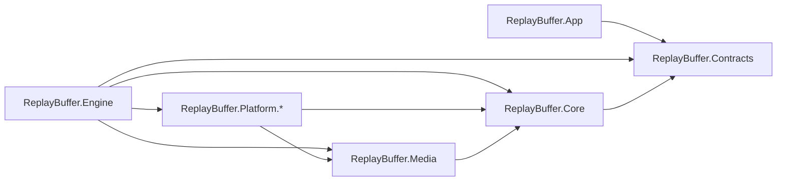
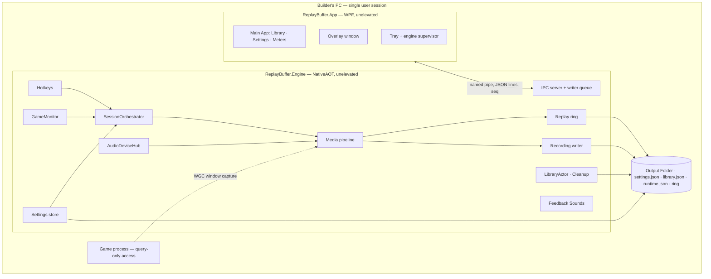

# Architecture Spine — Replay Buffer

## Design Paradigm

**Ports and adapters** in the engine:
- Domain logic depends only on ports.
- One **single-threaded orchestrator** (AD-19) owns every change to session, Target Game, Recording and mute state.
- Windows, D3D, WASAPI and FFmpeg sit behind adapters.

Media flows as **pipes and filters**: Sources → Processors → Encoders → encoded-packet bus → Sinks. The **Main App** is an MVVM client that only talks to the engine over IPC.

| Layer | Project(s) | Holds |
| --- | --- | --- |
| Contracts | `ReplayBuffer.Contracts` | IPC messages, settings key catalog and DTOs, event, warning and error registries |
| Domain | `ReplayBuffer.Core` | SessionOrchestrator, settings `Resolve`, Replay ring, OutputPathAllocator, LibraryActor, ports |
| Media pipeline | `ReplayBuffer.Media` | Filters: pacer, scaler, adaptive resampler, Track mixer and limiter; encoder and muxer ports |
| Adapters | `ReplayBuffer.Platform.*` | WGC/DXGI capture, AudioDeviceHub (WASAPI), FFmpeg, Hotkeys, process monitoring, file system, sounds |
| Engine host | `ReplayBuffer.Engine` | Composition root, IPC server, NativeAOT executable |
| Client | `ReplayBuffer.App` | WPF: Main App, Library, Settings, Overlay, tray, supervisor |

## Invariants & Rules



### AD-1 — Two processes, one owner per concern [ADOPTED]

- **Binds:** all
- **Prevents:** two components owning the same state; a UI crash stopping capture
- **Rule:**
  - The **engine** owns capture, encoding, the Replay Buffer, Recordings, Hotkeys, Feedback Sounds, Game Detection, settings, the library index and Cleanup.
  - The **Main App** owns UI, the Overlay, the tray and supervision. It never captures, encodes, writes settings, or opens media file contents. It may pass *paths* to the Windows shell: open, show in Explorer, the clipboard (`CF_HDROP`), and shell thumbnails (`IShellItemImageFactory`, `SIIGBF_THUMBNAILONLY`). It never asks for a thumbnail of an item that is being written.

### AD-2 — Dependency direction

- **Binds:** all projects
- **Prevents:** UI code reaching into the pipeline; native interop leaking into domain logic
- **Rule:**
  - The diagram above is the only allowed reference graph; `App` and `Engine` never reference each other.
  - Only `ReplayBuffer.Platform.*` contains `unsafe` code, P/Invoke, COM or FFmpeg calls.

### AD-3 — IPC protocol [ADOPTED]

- **Binds:** R8, R13, R19, R27, R28, R30, R31, R34; every epic that adds UI
- **Prevents:** incompatible message shapes; stale or duplicated state after a reconnect; a slow App stalling the engine
- **Rule:**
  - **Pipe:** one named pipe, `ReplayBuffer.Engine.v1.<instance>.<user SID>`. It's created with `FILE_FLAG_FIRST_PIPE_INSTANCE` and an ACL for the current user only. The App checks that the server's image path is in its install folder.
  - **Encoding:** UTF-8 JSON lines, serialized with source-generated `System.Text.Json`, in the envelope `{ v: 1, id, type: "noun.verb", payload }`.
  - **Commands** get exactly one reply, either a result or `{ error: { code, message } }`.
    - On disconnect, every pending command fails locally with `engine-disconnected`.
    - Mutating commands carry their target's identity (`expectedRevision`, or path + size + mtime) and are never auto-retried.
  - **Events** carry `seq`, a number that only increases within one engine instance. `state.snapshot { engineInstanceId, pid, seq, … }` is the first event on connect. It's built under the lock that assigns `seq`, and the App drops events with `seq` ≤ the snapshot's.
    - **Every state the App renders is a field of `state.snapshot`.** Contracts tests map each event type to its snapshot field.
    - Dismissing something is a command (`warning.dismiss`), never local App state.
  - **The Overlay and status line render only two shared shapes,** defined in Contracts:
    - `capture.stateChanged { replay: off|buffering|draining, recording: off|running, monitorRecording: off|running, micMuted, cooldownUntil }`
    - `warning.raised { id, code, severity, source, message, at, overlay, sound, dismissable }`
  - **Writes:** each connection has one writer thread fed by a bounded queue, and no other engine thread touches the pipe.
    - Coalescing types (`meters.levels`, at most 20 Hz; `estimate.changed`) keep only their latest value.
    - More than 1 000 queued events, or more than 5 s of lag, drops the connection, and the App gets a fresh snapshot on reconnect.

### AD-4 — Settings: owner, catalog, update protocol, Track Layout shape [ADOPTED]

- **Binds:** R2, R3, R15, R17, R18, R22, R25, R26, R29, R32, R35
- **Prevents:** lost updates; overrides merged or allowed differently by different epics; device references going stale
- **Rule:**
  - **Owner and storage:** the engine alone reads and writes `%APPDATA%\ReplayBuffer[-<instance>]\settings.json`. The document is `{ schemaVersion: 1, revision, global, profiles: { <profileId>: { name, ignored, recordingsEnabled, overrides } } }`.
  - **Key catalog:** `Contracts.Settings.Keys` is the closed catalog. Each key declares `{ type, default, overridable, appliesAt }`, and a key missing from the document takes its default.
    - **Overridable per Game Profile:** `trackLayout`, `video` (codec, resolution, fps, bitrate, rate control) and `bufferWindow`. Every other key is Global-only; an override of one is refused with `key-not-overridable`.
  - **Updates:** `settings.update { expectedRevision, ops: [ { scope, profileId?, key, op: set|remove, value } ] }`. A value replaces the key whole, and a revision mismatch returns `settings-conflict`.
    - The engine's own writes, such as profiles created automatically, go through the same queue.
    - Commit order: validate → write a temp file → replace → swap the in-memory document → broadcast `settings.changed { revision, document }`.
  - **Track Layout:** `trackLayout = { devices: [ { key, endpointId, friendlyName, parentName, flow, isMic } ], tracks: [ { id, name, deviceKeys, muteAffected } ] }`.
    - It's one inline value. There is no library of named layouts.
    - Rebinding a device to a new endpoint is a runtime matter and is never written back.
    - Editing a profile's layout copies Global's first, keeping the Track ids.
  - **Resolving:** there is exactly one `Resolve(SettingsDocument, ProfileId?)`, in Core, run on one immutable document reference.

### AD-5 — What is snapshotted and what is live

- **Binds:** R5, R9, R12, R17, R18, R25, R26
- **Prevents:** mid-Clip setting changes; an Ignored game still being captured; the mic coming back unmuted after a restart
- **Rule:**
  - **Snapshotted:** each session reads one `EffectiveSettings` (the overridable media keys plus `settingsRevision`) when it starts, and changes apply at the next Reset or the next Recording.
  - **Read live** from the Game Profile:
    - `ignored`: setting it on the Target ends the target with no drain.
    - `recordingsEnabled`: gates only *starting* a Recording.
    - `name`: read when a file path is allocated (AD-21).
  - **Mic mute** is engine runtime state, never part of the settings:
    - It's saved atomically to `%LOCALAPPDATA%\ReplayBuffer[-<instance>]\runtime.json` and restored before any session starts. A missing or corrupt file means muted.
    - Each toggle carries its Hotkey QPC, and every mixer applies it from that tick.

### AD-6 — One clock and defined stamps [ADOPTED]

- **Binds:** R4, R5, R11, R15, R33
- **Prevents:** drift, and cuts made at the handler's time instead of the press time
- **Rule:**
  - QPC ticks are the only timebase.
  - **Audio stamp:** WASAPI's `pu64QPCPosition` for the packet's first frame, converted to QPC ticks.
  - **Video stamp:** `Direct3D11CaptureFrame.SystemRelativeTime`, converted to QPC ticks.
  - **Hotkey stamp:** `QueryPerformanceCounter`, read as the first action on `WM_HOTKEY`.
  - Conversion to stream time happens only in the muxer.

### AD-7 — Media graph, encoder sharing, resource budget

- **Binds:** R4, R5, R10, R15, R16, R20, R21, R22, R36; NFR-2
- **Prevents:** needless or unbounded encoder chains; gaps hidden at a Reset; the GPU starving the game
- **Rule:**
  - **Pipeline:** Source → Processor → Encoder → encoded-packet bus → Sink. Nothing allocates managed memory per frame or per audio buffer.
  - **Sharing:** Sinks share an encoder chain exactly when they share a `ChainKey = (source identity, video keys, Track structure)`. Live mute and profile attributes are not part of the key.
  - **Budget:**
    - At most 2 video encoder chains run at once; a request for a third is refused with `encoder-budget`.
    - The engine uses one D3D11 device, on the Target Game's adapter.
    - File I/O runs at low I/O priority.
    - Both processes run unelevated, and GPU priority uses only `SetGPUThreadPriority`.
  - **Chain changes at a Reset:** when a pending settings change alters the Replay Buffer's `ChainKey`, the orchestrator builds the next chain in advance and switches to it at the press frame. If a gap can't be avoided, it raises `warning.raised { code: reset-gap }`.

### AD-8 — Replay ring of encoded packets [ADOPTED]

- **Binds:** R2, R3, R4, R5, R7, R12, R13
- **Prevents:** overwriting data a save is still reading; a Clip spanning two encoder generations
- **Rule:**
  - The ring holds encoded packets only, in reference-counted slabs: native memory in Memory mode, a preallocated `ring-<generation>.bin` in Disk mode. It keeps a keyframe index.
  - **Saves:** a save pins the slabs it reads, and the writer never blocks.
    - Pinned bytes count toward the Memory-mode RAM margin, and the oldest unpinned slabs go first. An unpinned ring under 1 s raises `memory-margin`.
  - **Generations:** a forced encoder restart opens a new generation, and **a generation boundary counts as a Reset for Clips**. A Clip holds one generation. A save within 1 s of a boundary uses the previous generation, if that holds at least 1 s.
  - **Resizing** allocates a new ring; the old one is released when its last pin drops.

### AD-9 — Containers and the file-write protocol

- **Binds:** R4, R7, R11, R12, R26, R27, R33
- **Prevents:** crash-unsafe Recordings; Clips that won't play everywhere; a half-written file showing up as a Library item
- **Rule:**
  - **Recordings and Monitor Recordings** are fragmented MP4, written in place, with a fragment flushed at least every 1 s.
  - **Clips** are complete MP4 files with the index at the front (faststart). Each is written to `<final>.rbpart` in the same folder, then renamed. (Deviates from PLAN.md's fMP4-everywhere; confirmed by the user.)
  - **Audio:** AAC-LC at 48 kHz, one stream per Track, with the stream `title` set to the Track name and Track 1 marked default.
  - **Writers** open files with `FILE_SHARE_READ | FILE_SHARE_DELETE`. Every writer calls `Library.BeginWrite` before creating a file, and `EndWrite(outcome)` after the rename or final flush.

### AD-10 — Save cut

- **Binds:** R4, R5
- **Prevents:** Clips that start late, or overlap the previous one by more than one frame
- **Rule:**
  - A Clip's last video frame is the last frame with capture QPC ≤ the Hotkey QPC, and its audio is cut at the Hotkey QPC.
  - The encoder is asked for a keyframe on the next frame, which starts the next Clip. Otherwise the GOP is at most 1 s.
  - The Save Cooldown is measured from the Hotkey QPC.

### AD-11 — Hotkeys [ADOPTED]

- **Binds:** R9, R18, R21, R32, R34
- **Prevents:** Hotkeys dying with the UI; three binding schemas; anti-cheat flags
- **Rule:**
  - The engine registers Hotkeys with `RegisterHotKey`, on a dedicated message-only-window thread. The App never registers Hotkeys, and `WH_KEYBOARD_LL` is forbidden.
  - **Bindings:** `global.hotkeys: { <HotkeyAction>: { vk, modifiers } | null }` plus `global.recordHotkeyMode`. `HotkeyAction` is a closed enum: `save`, `micMute`, `recordToggle`, `recordStart`, `recordStop`, `monitorRecordToggle`.
  - Bindings are Global-only and apply as soon as a settings change commits.
  - Duplicates are refused with `hotkey-duplicate`. Each registration result goes out as `hotkey.status` and is part of the snapshot.

### AD-12 — Capture APIs and process access [ADOPTED]

- **Binds:** R20, R21, R23; NFR-3
- **Prevents:** injection, intrusive access to game processes, and whole-monitor capture in game sessions
- **Rule:**
  - **Capture APIs:** the game window is captured only through Windows.Graphics.Capture, with a window item. Monitor Recording uses a WGC monitor item, with DXGI Desktop Duplication as a fallback for monitors only.
  - **Game process access:** a game process is opened only with `PROCESS_QUERY_LIMITED_INFORMATION`. No memory reads, no module enumeration, no hooks of any type, and WinEvents only out of context.
  - The product name comes from the executable on disk, and no code is ever loaded into another process.

### AD-13 — Audio processing [ADOPTED]

- **Binds:** R14, R15, R16, R18, R19, R33
- **Prevents:** device-clock drift, clipping, and mixers aligning audio differently
- **Rule:**
  - **Capture:** Output Devices are captured by loopback and Input Devices by capture, in WASAPI shared mode, event-driven, on MMCSS threads, through AudioDeviceHub (AD-20).
  - **Per device:** gaps are filled with silence. **Exactly one adaptive resampler per device** (in `ReplayBuffer.Media`) converts to 48 kHz float and is steered so its sample count tracks elapsed QPC.
  - **Mixing:** mixers align sources by QPC. A Track's audio is the sum of its sources through a limiter that acts only above full scale.
  - **Mute:** silences `isMic` devices before the mix, and only in Tracks marked `muteAffected`.

### AD-14 — Interop and media stack [ADOPTED]

- **Binds:** all of `ReplayBuffer.Platform.*`
- **Prevents:** two interop stacks for one API family; code that only fails under NativeAOT
- **Rule:**
  - **Win32 and COM** go through CsWin32 only, with `CsWin32RunAsBuildTask` and `DisableRuntimeMarshalling`.
  - **WGC** goes through the Windows SDK projection selected by the target framework. The interop hand-offs (`IGraphicsCaptureItemInterop`, `IDirect3DDxgiInterfaceAccess`) use raw ABI pointers converted with `FromAbi`.
  - **FFmpeg** goes only through `FFmpeg.AutoGen.Abstractions` + `FFmpeg.AutoGen.Bindings.DynamicallyLinked`. Encoding uses hardware encoders with D3D11 frames; x264 is the fallback.
  - **NativeAOT:** the engine builds with trimming and AOT warnings treated as errors, and uses no reflection-based serialization.
  - Epic 1's stack comparison may replace the pipeline adapters with a native C++ core behind the same ports.

### AD-15 — Overlay, sounds and capture exclusion [ADOPTED]

- **Binds:** R6, R8, R13, R18, R21
- **Prevents:** feedback sounds recorded into Clips; app windows appearing in captures
- **Rule:**
  - **Overlay:** a topmost, click-through, never-activated WPF window in the App that renders only `capture.stateChanged` and `warning.raised`. It dies with the App; the engine's sounds cover that gap.
  - **Feedback Sounds** are played by the engine on `global.feedbackSoundDevice`, which defaults to the default communications endpoint. If any Track loopback-captures that endpoint, validation warns with `feedback-device-captured`.
  - Every window the app creates sets `WDA_EXCLUDEFROMCAPTURE`.

### AD-16 — Supervision, lifecycle, privilege, environments [ADOPTED]

- **Binds:** R9, R31, R34, R35
- **Prevents:**
  - orphaned or hung engines, and a crashed App never coming back;
  - Recordings starting themselves after a restart;
  - dev builds colliding with the daily copy.
- **Rule:**
  - **Startup:** Start with Windows launches the App through the HKCU `Run` key, pointing at `%LOCALAPPDATA%\Programs\ReplayBuffer`, and the App launches the engine. Both run unelevated.
  - **Supervision runs both ways:**
    - The App restarts an engine that crashed, or is hung. The engine counts as hung after 3 missed `engine.heartbeat` events (sent every 2 s), or when a command has had no reply for 10 s; the App kills it by its PID.
    - The engine relaunches an App that died unexpectedly.
  - **Quitting:** tray **Quit** sends `engine.shutdown` and waits up to 5 s, so a pending save can finish. Closing the Main App window only hides it.
  - **After a restart** only the Replay Buffer resumes. If a Recording was running, `warning.raised { code: recording-interrupted }` is raised.
  - **Single instance:** a named mutex per instance keeps one copy of each process; `WAIT_ABANDONED` counts as acquired.
  - **Instances:** the instance name (`ReplayBuffer`, or `ReplayBuffer-Dev`) is appended to the pipe, the mutexes and the data folders. A dev instance starts with no Hotkeys bound.

### AD-17 — Library index and Cleanup

- **Binds:** R7, R26, R27, R28, R29
- **Prevents:** losing Favourites, Cleanup deleting the wrong file, and races between Library mutations
- **Rule:**
  - **LibraryActor:** a single-threaded actor in Core. It handles watcher events, IPC commands, `BeginWrite`/`EndWrite`, and every Cleanup step, and it re-checks Favourite and being-written status immediately before each delete.
    - The engine's own renames and deletes are registered in advance, so their watcher echoes are ignored.
    - A rename made outside the app moves the item's metadata to the new path.
  - **Index file:** `library.json` holds items keyed by path relative to the Output Folder, each with the `profileId` recorded at `BeginWrite`; the Library groups items by `profileId`. The file is written atomically, with a `.bak`. If neither copy parses, `library-corrupt` is raised and Cleanup stays off until the user acknowledges it.
  - **Cleanup:** never runs in the first 60 s after start, or before the first folder scan has been reconciled. It considers only indexed `*.mp4` items.
  - **Temporary files:** `*.rbpart` files are always ignored, and deleted when the engine starts.
  - **Paths:** the being-written set holds absolute paths. Changing `outputFolder` rebuilds the index from the new folder only. `ringPath` can't be inside `outputFolder` (`ring-path-invalid`).

### AD-18 — Game Detection [ADOPTED]

- **Binds:** R1, R23, R24, R25
- **Prevents:** two owners of the Target Game; one game ending up with two profiles; ambiguous lifecycle transitions
- **Rule:**
  - **Detection:** `GameMonitor` detects games and *proposes* Target changes; the orchestrator (AD-19) commits them. A Game Profile id comes from exactly one `Canonicalize(path)` in `Platform.Windows`: `GetFinalPathNameByHandle(FILE_NAME_NORMALIZED | VOLUME_NAME_DOS)`, with `\\?\` stripped, in lowercase. Processes under the install folder are never detected.
  - **What drives the buffer:** only `target.changed { from, to, reason: focus|exit|ignored|detected|cold-start }` drives the Replay Buffer; `game.detected` and `game.exited` are informational.
  - **When the Target exits:**
    - If another game is detected, `to` is the most recently focused one, chosen immediately.
    - The 30 s drain exists only when `to` is null. A `target.changed` during a drain ends the drain.
    - There is at most one Replay Buffer at a time.
  - **On a cold start:** the Target is the foreground detected game, otherwise the most recently started one, chosen immediately.

### AD-19 — Single-threaded SessionOrchestrator [ADOPTED]

- **Binds:** R1, R4, R5, R9, R10, R12, R17, R18, R21, R24
- **Prevents:** two components owning one session; a Target switch racing a Record press; state mutated from several threads
- **Rule:**
  - **Ownership:** `SessionOrchestrator` in Core is the only component that creates, Resets, retargets or ends sessions, commits Target changes, Recording state and mic mute, and emits `capture.stateChanged`.
  - **Input:** it runs on one thread, reading a single-reader `Channel`. Hotkey, GameMonitor, settings, IPC and writer-completion inputs post messages to it, which are processed in arrival order.
  - **Media threads** never block on it; they post completions back.
  - **Target changes:**
    - Changing the Target Game is always end-session plus new-session, with a fresh snapshot.
    - A source is retargeted in place only when the same process's window changes (R20).
    - A running game Recording blocks a Target switch; a Monitor Recording never does. When the blocking Recording stops, the switch is re-evaluated at once.

### AD-20 — AudioDeviceHub: one client per device

- **Binds:** R14, R15, R19, R30, R33
- **Prevents:** two owners of an audio device; meters and sessions disagreeing about device state
- **Rule:**
  - `AudioDeviceHub` (in `Platform.Audio`, behind a Core port) holds at most one WASAPI client per endpoint for the whole engine. It handles binding, rebinding through `IMMNotificationClient`, silence fill, resampling (AD-13) and stamping.
  - It publishes PCM on a fan-out, the only allowed tap before the encoders. Session and meter mixers subscribe to it and never open devices themselves.
  - `meters.watch { layout }` builds a mixer for meters only, and `meters.unwatch` releases it.
  - A device stays open only while it has a subscriber.
  - Dropouts are raised as `warning.raised { code: device-dropout, overlay: false }`.

### AD-21 — OutputPathAllocator

- **Binds:** R7, R21, R26
- **Prevents:** two writers getting the same file name; folders colliding
- **Rule:**
  - `OutputPathAllocator` in Core is the only producer of output paths. It allocates when a writer is created, from the profile's *current* name and the local time of the Hotkey QPC (Clip) or start QPC (Recording).
  - It reserves the path atomically with `CREATE_NEW`, adding `_2`, `_3`… on a collision.
  - `Monitor Recordings` is a reserved folder, and profile folder names are unique (` (2)` is appended).
  - Characters Windows doesn't allow are replaced, and nobody caches a resolved path.

### AD-22 — Contracts evolve additively; epic 1 seeds them

- **Binds:** all epics; R35
- **Prevents:** epics 2 and 3, built in parallel, producing two different "v2" schemas or message unions
- **Rule:**
  - Through v1, `schemaVersion` and the IPC `v` stay 1.
  - Changes are additive only: new keys carry defaults, and new messages and fields are optional.
  - A rename or removal needs a spine update first, and migrations live in one ordered `SettingsMigrations` registry.
  - **Epic 1 ships first:**
    - the complete key catalog (AD-4), with types and defaults;
    - `SessionSpec { kind, target, snapshot, audio }`;
    - the Orchestrator `Channel`;
    - the AudioDeviceHub port;
    - the IPC `seq`/snapshot mechanism;
    - one Contracts message file per epic area (`Audio.cs`, `Game.cs`, `Capture.cs`, `Library.cs`, `Recording.cs`, `Feedback.cs`).

## Consistency Conventions

| Concern | Convention |
| --- | --- |
| Naming | Namespaces `ReplayBuffer.<Layer>.<Area>`. IPC types are `noun.verb`, lowercase. JSON keys are camelCase. Domain terms are the PRD Glossary's, verbatim. |
| Ids | Game Profile: `Canonicalize(path)`. Track: a GUID, stable across renames and copies. Layout device: a layout-local GUID `key`. Audio Device: the MMDevice endpoint ID. Library item: path relative to the Output Folder, plus `profileId`. |
| Time | QPC ticks in the engine. ISO 8601 UTC in JSON. Local time in file names, `<Game>_<yyyy-MM-dd_HH-mm-ss>.mp4`. |
| Errors and warnings | Command errors are `{ code, message }`; user-facing problems are `warning.raised`. Every code is kebab-case and listed in one `Contracts.ErrorCodes` registry. |
| Logging | Structured logging through `Microsoft.Extensions.Logging`, with an AOT-safe rolling-file provider chosen in epic 1, to `%LOCALAPPDATA%\ReplayBuffer[-<instance>]\logs\{engine,app}-*.log`. Crash dumps go through WER LocalDumps into `…\dumps\`. |
| Data locations | Settings and library: `%APPDATA%\ReplayBuffer[-<instance>]\`. Runtime state, Disk ring and logs: `%LOCALAPPDATA%\ReplayBuffer[-<instance>]\`. The Output Folder is chosen in Settings. |
| Units | Audio is 48 kHz 32-bit float internally. Sizes are in bytes. Durations are QPC ticks internally and seconds in settings. |
| Hot path | No allocation per frame or audio buffer, pooled native buffers, MMCSS "Pro Audio", and no I/O or IPC on capture threads. |
| Tests | Every project has a matching `*.Tests` project. Media checks run `ffprobe` on produced files. A Contracts test checks that every event maps to a snapshot field. Benchmarks live in `ReplayBuffer.Bench`. |

## Stack

| Name | Version |
| --- | --- |
| .NET SDK (global.json, rollForward latestPatch) | 10.0.402 |
| .NET runtime | 10.0.13 |
| C# | 14 |
| Engine publish | NativeAOT, win-x64 |
| Target framework | net10.0-windows10.0.26100.0 |
| Minimum OS (SupportedOSPlatformVersion) | Windows 11 24H2, 10.0.26100.0 |
| WPF | ships with .NET 10 |
| Microsoft.Windows.CsWin32 | 0.3.367 |
| FFmpeg.AutoGen.Abstractions + FFmpeg.AutoGen.Bindings.DynamicallyLinked | 9.0.1.1 |
| FFmpeg native | 9.0.2, BtbN month-end `win64-gpl-shared-9.0` asset, SHA-256 pinned in `tools/fetch-ffmpeg.ps1` |
| H.NotifyIcon.Wpf | 2.4.1 |

## Structural Seed



```text
ReplayBuffer/
  global.json                       # SDK 10.0.402
  src/
    ReplayBuffer.Contracts/         # messages per area, settings key catalog, ErrorCodes
    ReplayBuffer.Core/              # orchestrator, Resolve, ring, path allocator, LibraryActor, ports
    ReplayBuffer.Media/             # filters: pacer, scaler, resampler, mixer; encoder/muxer ports
    ReplayBuffer.Platform.Capture/  # WGC, DXGI Desktop Duplication
    ReplayBuffer.Platform.Audio/    # AudioDeviceHub (WASAPI, MMDevice)
    ReplayBuffer.Platform.FFmpeg/   # encode/mux via FFmpeg.AutoGen bindings
    ReplayBuffer.Platform.Windows/  # Hotkeys, GameMonitor, Canonicalize, file system, sounds
    ReplayBuffer.Engine/            # composition root, IPC server (NativeAOT exe)
    ReplayBuffer.App/               # WPF Main App, Overlay, tray, supervisor
  tests/                            # *.Tests per project
  bench/ReplayBuffer.Bench/         # FPS / drift benchmark harness
  tools/fetch-ffmpeg.ps1            # downloads the pinned FFmpeg asset, checks SHA-256
  native/ffmpeg/                    # FFmpeg DLLs (not committed)
```

**Deployment and operations:**
- **Install and run:** one PC, one user. `dotnet publish` puts the engine (NativeAOT) and the App (framework-dependent, .NET 10 Desktop Runtime) in one folder, with the FFmpeg DLLs beside the engine. That folder is copied to `%LOCALAPPDATA%\Programs\ReplayBuffer`.
- **Update:** tray Quit, copy the new build, relaunch.
- **Development:** dev runs use the `ReplayBuffer-Dev` instance. There are no servers, no network services, no installer and no CI.

## Capability → Architecture Map

| Capability / Area | Lives in | Governed by |
| --- | --- | --- |
| R1, R24 Replay Buffer lifecycle, Target switch | Core (orchestrator), Platform.Windows (GameMonitor) | AD-19, AD-18 |
| R23, R25 Game Detection, Game Profiles | Platform.Windows, Core | AD-18, AD-12, AD-4 |
| R2–R5, R7 Replay Buffer, Clips, save cut | Core (ring, orchestrator), Media, Platform.FFmpeg | AD-5, AD-7, AD-8, AD-9, AD-10 |
| R6, R8 Overlay, sounds, status line | App (Overlay), Platform.Windows (sounds) | AD-15, AD-3 |
| R9–R13, R21 Recordings, Monitor Recording | Core (orchestrator), Media, Platform.Capture, Platform.FFmpeg | AD-19, AD-7, AD-9, AD-12 |
| R14–R16, R18, R19, R30 audio Tracks, mute, dropouts, meters | Platform.Audio (AudioDeviceHub), Media (mixer) | AD-20, AD-13, AD-5, AD-6 |
| R17, R22 Output Settings, per-profile overrides | Contracts (key catalog), Core (Resolve), Engine (settings store) | AD-4, AD-5 |
| R20 window capture, fixed output resolution | Platform.Capture, Media (scaler, pacer) | AD-12, AD-7 |
| R26 folders and file names | Core (OutputPathAllocator) | AD-21 |
| R27–R29 Library, Cleanup | Core (LibraryActor), App (shell actions) | AD-17, AD-1 |
| R31, R34, R35 startup, supervision, hands-off | App (supervisor), Engine | AD-16, AD-22 |
| R32 Hotkeys | Platform.Windows | AD-11 |
| R33, R36 drift, FPS | Bench, Media | AD-6, AD-13, AD-7 |
| NFR-2, NFR-3 constraints | all | AD-1, AD-2, AD-7, AD-11, AD-12, AD-16 |

## Deferred

- **Color conversion path** (PLAN.md §7.2): epic 1's comparison picks it inside `Platform.Capture`/`Platform.FFmpeg`. The GPU priority stays bounded by AD-7 and AD-16, with no elevation.
- **Whether the engine ships as NativeAOT:** this is the target. Epic 1's tracer passes only with a `PublishAot` build that has no IL2xxx/IL3xxx warnings and does a working encode and mux. If that fails, the engine ships framework-dependent, and no AD changes.
- **Per-epic message payloads:** each epic adds its own message payloads in its Contracts file, under AD-3 and AD-22. The shared shapes are already fixed in AD-3.
- **Thumbnail caching, Library UI layout, Overlay visuals and sound assets:** these belong to epics 7 and 5. Epic 5 checks that `WDA_EXCLUDEFROMCAPTURE` works on the layered Overlay window.
- **The rolling-file logging provider, the test framework, and package versions beyond the Stack table:** epic 1's scaffold chooses them, and the code owns them after that.
- **Out of v1:** HDR (HEVC 10-bit), more than one GPU, an installer, CI, auto-update, and telemetry.
